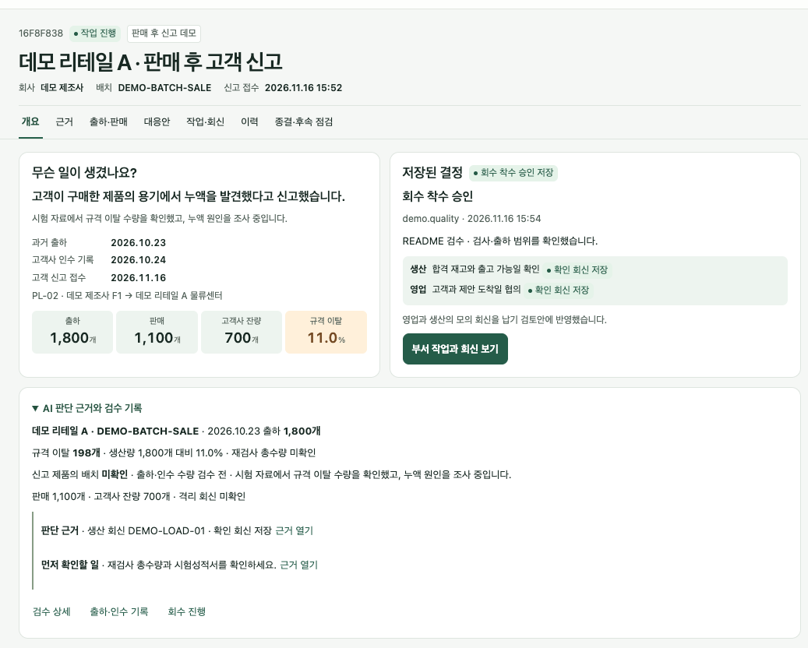

<div align="center">

# Aurora Quality & Recovery

[](https://nodejs.org/en/download)
[](https://www.postgresql.org/docs/16/)
[](https://react.dev/)
[](https://fastify.dev/)

**판매 후 품질 신고에서 회수 착수와 대체 납기를 결정하는 웹 데모**

AI가 검사·출하·재고 근거를 정리하면 품질 승인자가 결정합니다. 영업·생산의 회신이 쌓이면 AI가 다음 확인할 일을 제안합니다.

[처음 실행](#quick-start) · [승인·반려 체험](#demo) · [AI 연결](#ai) · [검증](#verification) · [코드 구성](#structure)

</div>



*공개 데모의 실제 화면입니다. 등장하는 고객, 수량, 근거와 회신은 가상 자료입니다.*

## 📦 무엇을 할 수 있나요

| 단계 | 화면에서 확인할 수 있는 내용 |
| --- | --- |
| **근거 확인** | 신고 시점, 배치별 확정 이탈, 출하·고객 인수 범위를 한 사건에 모읍니다. 근거 원문과 확인이 필요한 항목을 다시 열 수 있습니다. |
| **공급 대안 비교** | 창고별 합격 가용 재고와 납기 조건을 계산합니다. 가상 물류 이력 100건에서 같은 경로의 인도 결과와 비용을 요약합니다. |
| **사람의 의결** | 품질 승인자가 대상·수량·근거를 보고 승인 또는 반려를 저장합니다. 의결에 맞춰 영업·생산의 후속 업무가 바뀝니다. |
| **업무와 후속안** | 두 부서가 확인하면 모의 납기안을 만듭니다. AI는 저장된 의결·회신으로 후속안을 작성하고, 종결 승인 시 담당자에게 점검 티켓을 배정할 수 있습니다. |

```text
고객 신고 → 검사·출하·재고 대조 → AI 대응안 → 품질 승인자
                                               ├─ 승인 → 회수 착수 업무 + 영업·생산 확인
                                               └─ 반려 → 영업·생산 보완 확인
부서 회신 → AI 후속안 → 종결 검토 → 후속 점검 티켓
```

회수·출고·고객 통지·납기는 앱 안에서 모의 기록으로 처리합니다.

<a name="quick-start"></a>

## 🚀 처음 실행하기

Git, [Node.js](https://nodejs.org/en/download) 22.12 이상, [PostgreSQL 16](https://www.postgresql.org/download/)을 준비합니다. 기본 모의 AI는 별도 계정이나 API 키 없이 작동합니다.

### 1. 저장소 받기

```sh
git clone https://github.com/coreline-ai/aurora-quality-recovery.git
cd aurora-quality-recovery
node --version
npm --version
cp .env.example .env
chmod 600 .env
```

PowerShell에서는 `cp`와 `chmod` 두 줄 대신 `Copy-Item .env.example .env`를 실행합니다. 명령은 클론한 폴더에서 실행합니다.

### 2. 로컬 PostgreSQL 연결

**이미 로컬 PostgreSQL 16이 실행 중이면** 설치 때 만든 관리자 이름·비밀번호와 포트를 사용합니다. 기본 포트는 `5432`입니다. 앱은 첫 실행에 이 계정으로 별도 데모 DB와 로그인 역할을 만들고, 새 DB에 `pgcrypto`를 설치합니다. 기존 업무 DB 대신 관리 DB인 `postgres`에 연결하세요.

**PostgreSQL 16 실행 파일만 설치했다면** macOS·Linux의 Bash 또는 Zsh에서 아래처럼 전용 서버를 띄울 수 있습니다. `initdb --version`이 실행되지 않으면 설치된 PostgreSQL 16의 `bin` 디렉터리를 PATH에 추가하세요. `initdb`는 최초 한 번만 실행합니다. 암호 입력 창에서 이 데모 전용 비밀번호를 설정하세요.

```sh
mkdir -m 700 -p .aurora-demo
initdb -D .aurora-demo/postgres --username=aurora_admin --auth=scram-sha-256 --encoding=UTF8 --pwprompt
pg_ctl -D .aurora-demo/postgres -l .aurora-demo/postgres.log -o "-h 127.0.0.1 -p 15432" -w start
```

편집기로 `.env`를 열고 빈 `ADMIN_DATABASE_URL`에 아래 형식으로 값을 입력합니다. 위 전용 서버를 쓰면 `DB_USER`는 `aurora_admin`, `DB_PORT`는 `15432`입니다. `< >`까지 자신의 값으로 바꾸세요. 비밀번호에 `@`, `#`, `:`, `/` 같은 URL 특수문자가 있으면 해당 문자를 퍼센트 인코딩합니다.

```dotenv
ADMIN_DATABASE_URL=postgresql://<DB_USER>:<DB_PASSWORD>@127.0.0.1:<DB_PORT>/postgres
```

### 3. 설치하고 로그인

```sh
npm ci
npm run build
npm run demo
```

터미널에 `Server listening`이 표시되면 [로컬 데모](http://127.0.0.1:11443/)를 엽니다. [상태 확인](http://127.0.0.1:11443/health)에 `{"status":"ok"}`가 표시되면 DB도 연결된 상태입니다. 서버는 켜 둔 채 같은 폴더에서 두 번째 터미널을 열고 `npm run demo:accounts`를 실행합니다. 생성된 각 역할의 비밀번호는 터미널에서만 확인합니다.

다시 시작할 때는 같은 데모 DB와 계정을 사용합니다. 이 안내로 전용 PostgreSQL을 만들었다면 다음 실행 때도 `pg_ctl … start`로 먼저 켭니다. 사용을 마치면 앱 터미널에서 Ctrl+C를 누르고, 전용 PostgreSQL은 `pg_ctl -D .aurora-demo/postgres -m fast -w stop`으로 종료합니다. `.env`와 `.aurora-demo/`는 Git에서 제외됩니다.

<a name="demo"></a>

## ⚡ 승인과 반려를 한 번씩 따라가기

| 계정 | 시연에서 맡는 일 |
| --- | --- |
| `demo.intake` | 사건 접수, 대응안 생성·검토 요청, 모의 작업 처리, 종결 검토 작성 |
| `demo.quality` | 회수 착수 승인·반려와 최종 종결 결정 |
| `demo.sales` | 고객이 수용할 도착일 확인 |
| `demo.production` | 합격 재고·출고 가능일과 창고 경로 확인 |
| `demo.group` | 유통사 공급 약정의 상위 승인 시연 |

1. **`demo.intake`**로 로그인합니다. **품질 사건 → 새 사건 접수(＋)**에서 사건 유형을 **데모 리테일 A · 오늘 판매 후 신고 데모**로 선택하고 **사건 접수**를 누릅니다. 사건 제목 왼쪽의 코드를 적어 두면 계정을 바꾼 뒤에도 같은 사건을 찾을 수 있습니다.
2. **AI 판단 자료 만들기**를 누릅니다. 저장 알림이 뜨면 **대응안 → AI 실행 이력**에서 **모의 AI · demo-rules-v1**, **저장 완료**를 확인합니다. **검토 요청**을 누르고 로그아웃합니다.
3. **`demo.quality`**로 로그인합니다. **승인 대기 → 해당 사건 → 안건 검토**에서 **회수 착수 승인**과 사유를 입력하고 **결정 저장**을 누릅니다.
4. 계정을 바꿔 **품질 사건 → 해당 사건 → 작업·회신 → 모의 회신 등록**을 엽니다. **확인 회신 등록**을 선택하고 각 계정에서 **회신 저장**을 누릅니다.

   | 계정 | 입력 예시 |
   | --- | --- |
   | `demo.production` | 근거 번호 `DEMO-LOAD-01`, 확인 내용 `합격 재고와 상차를 확인했습니다`, 재고 **1,500개**, 화면의 **출고 마감일**을 가능 출고일로 입력합니다. 출고 가능과 창고 확인란을 체크합니다. |
   | `demo.sales` | 근거 번호 `DEMO-SALES-01`, 확인 내용 `고객이 도착일에 동의했습니다`, 화면의 **도착 마감일**을 동의한 도착일로 입력하고 고객 동의 확인란을 체크합니다. |

   첫 회신 후에는 납기 미확정입니다. 두 회신을 저장하면 **모의 납기안**이 표시됩니다. 회신 창의 날짜는 접수일에 따라 달라집니다.

5. **`demo.intake`**로 해당 사건을 다시 열고 **작업·회신 → 저장된 의결·회신으로 AI 후속안 작성**을 누릅니다. **대응안**에서 2번 대응안이 열리고, **작업·회신**에 두 부서 회신과 모의 납기안이 남는 것을 확인합니다.
6. 반려를 보려면 같은 유형으로 **새 사건**을 만들어 1~2단계를 반복합니다. 이번에는 **`demo.quality`**로 **반려**를 선택해 사유를 저장합니다. **작업·회신**에서 영업·생산 보완 업무 2건과 **대체 납기 미확정**을 확인합니다. 회수 착수 작업은 생성되지 않습니다.

| 더 둘러볼 사례 | 확인할 결과 |
| --- | --- |
| **일반 품질 사건 및 S1~S3** | 가상 배치 `DEMO-BATCH-01`로 정상 처리, 검사 정정, 출하 추적 공백을 확인합니다. |
| **N5 · 재공급 문제** | 김포 재고가 검사 보류됐을 때 F1 **1,800개**와 인천 **200개**로 분할하는 대안을 확인합니다. |
| **N1 · 생산 기록** | 원료와 생산 기록의 대사 작업을 처리하고, 품질 증빙으로 종결을 승인한 뒤 다음 점검 티켓을 확인합니다. |

<a name="ai"></a>

## ⚙️ 실제 AI 연결

기본 **모의 AI**는 앱이 검증한 행동과 근거 중에서 규칙으로 응답합니다. 실제 GPT 호출을 시험하려면 앱과 같은 사용자로 로그인한 Codex CLI를 준비하고 `codex login status`로 상태를 확인합니다. `.env`에서 다음 설정을 수정한 뒤 앱을 재시작합니다.

| 설정 | 입력할 값 |
| --- | --- |
| `AURORA_AI_PROVIDER` | 기본 데모는 `demo`, 실제 GPT를 호출하려면 `codex` |
| `AURORA_CODEX_MODEL` | Codex를 사용하는 계정으로 접근할 수 있는 모델 이름 |
| `AURORA_CODEX_BIN` | 같은 터미널에서 `codex --version`이 작동하면 빈 값. PATH에서 찾지 못하면 로컬 실행 파일의 절대 경로 |

새 대응안의 **AI 실행 이력**에서 **Codex exec**와 **저장 완료**를 확인합니다. AI가 고른 근거와 제안은 검토용으로 저장되며 의결은 승인자 계정에서 진행합니다.

<a name="verification"></a>

## ✅ 검증하기

```sh
npm test           # AI 호출 계약과 물류 데이터 검증
npm run test:demo  # 실행 중인 로컬 데모의 HTTP·DB 통합 검증
```

통합 검증은 서버를 켠 상태에서 별도 터미널로 실행합니다. 가상 사건을 추가해 승인·반려, 부서 회신과 AI 후속안, 종결 후 점검 티켓 생성과 완료 증빙을 검증합니다. 실제 Codex로 테스트할 때 Bash·Zsh에서는 `DEMO_EXPECTED_PROVIDER=codex_exec npm run test:demo`, PowerShell에서는 `$env:DEMO_EXPECTED_PROVIDER='codex_exec'; npm run test:demo`를 실행합니다. 다른 포트에서는 테스트 환경 변수 `DEMO_ORIGIN`에 해당 로컬 주소를 지정합니다.

## 🔧 실행이 막힐 때

| 메시지 또는 증상 | 확인할 곳 |
| --- | --- |
| `ADMIN_DATABASE_URL` 오류 | 클론 폴더의 실제 파일명이 `.env`인지, 관리 DB 주소가 채워져 있는지 확인합니다. |
| `ECONNREFUSED`, 인증 오류, 권한 오류 | PostgreSQL이 시작됐는지, `.env`의 포트·계정·비밀번호가 맞는지 확인합니다. 첫 실행에는 DB·역할 생성 권한과 새 DB의 확장 설치 권한이 필요합니다. |
| `EADDRINUSE` | 앱 포트가 이미 사용 중입니다. `.env`에서 `AURORA_PORT=11444`처럼 빈 포트를 지정한 뒤 같은 포트로 접속합니다. |
| 대응안에서 AI 오류 | 기본 데모는 `AURORA_AI_PROVIDER=demo`로 설정합니다. Codex는 로그인, 모델 접근 권한, CLI 경로를 확인하고 앱을 다시 시작합니다. |

<a name="structure"></a>

## 📁 코드 구성

| 경로 | 역할 |
| --- | --- |
| [`web/`](web/) | React로 사건 상세, 승인·반려, 작업·회신, 운영 현황을 표시합니다. |
| [`server/`](server/) | Fastify API로 근거, 권한, 의결, 부서 회신을 다룹니다. [AI 대응안](server/ai.mjs)과 [종결·후속 티켓](server/closure.mjs) 로직이 있습니다. |
| [`db/`](db/) | PostgreSQL 스키마와 회사별 접근 정책을 정의합니다. |
| [`data/`](data/) · [`demo-sources.mjs`](server/demo-sources.mjs) | 가상 현장 상황, 창고 재고, 품질 검토용 근거를 제공합니다. |
| [`scripts/demo.mjs`](scripts/demo.mjs) · [`test/`](test/) | 로컬 데모를 초기화하고 정책, AI 호출과 저장 흐름을 검증합니다. |
